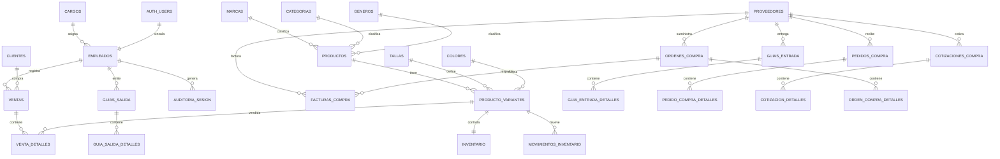

# Fimaza Multiplataforma

Sistema de gestión de inventario, ventas y compras para negocios de calzado. Funciona en web, Android e iOS con Expo y Supabase.

- Producción: `https://fimaza.ruisu.tech`
- Supabase: PostgreSQL + Auth + RLS + Edge Functions
- Deploy web: Vercel
- Backups: GitHub Releases cifrados con GPG

## Estado actual

El sistema está operativo para uso interno/admin con estas vistas:

- Login y recuperación de contraseña.
- Panel principal.
- Gestión: Usuarios, Clientes, Productos y Proveedores.
- Ventas: Carrito de compras y boleta PDF.
- Reportes: Reporte de ventas y exportación CSV.
- Almacén: Guía de salida, guía de entrada, inventario y faltantes.
- Compras: Pedidos, cotizaciones, orden de compra y facturas.
- Colaboradores: pantalla de “Módulos en preparación”.

## Stack

| Área | Tecnología |
| --- | --- |
| Framework | Expo SDK 54, React Native 0.81, React 19 |
| Router | expo-router v6 |
| Lenguaje | TypeScript estricto |
| Backend | Supabase PostgreSQL |
| Auth | Supabase Auth |
| Seguridad | RLS + RPCs `security definer` |
| Archivos | expo-file-system, expo-sharing |
| PDF | expo-print |
| Tests | Playwright |
| Web deploy | Vercel |

## Requisitos

- Node.js 22+
- npm
- Proyecto Supabase con Auth habilitado
- Cuenta Vercel para despliegue web
- Opcional: cuenta EAS para Android/iOS

## Inicio rápido

```bash
git clone https://github.com/RuisuTech/Fimaza.git
cd Fimaza
npm install
```

Crea `.env.local`:

```env
EXPO_PUBLIC_SUPABASE_URL=https://TU-PROJECT-REF.supabase.co
EXPO_PUBLIC_SUPABASE_ANON_KEY=TU_ANON_KEY
```

Inicia la app:

```bash
npx expo start --web
```

La app queda disponible en `http://localhost:8081`.

## Credenciales

Las credenciales de acceso **no se publican en el repositorio**. Se entregan por un canal seguro.

Usuarios base:

- `admin` — Administrador
- `vendedora01` — Colaborador

Si alguna credencial se compartió en texto plano, debe rotarse.

## Scripts

| Comando | Descripción |
| --- | --- |
| `npm start` | Inicia Expo |
| `npm run web` | Inicia la versión web |
| `npm run android` | Inicia Android |
| `npm run ios` | Inicia iOS |
| `npm run lint` | Ejecuta ESLint |
| `npm run typecheck` | Ejecuta TypeScript sin emitir |
| `npm run export:web` | Genera el build web en `dist/` |
| `npm run test:e2e` | Ejecuta Playwright |
| `npm run test:e2e:ui` | Abre Playwright UI |

## Base de datos

Migraciones en `supabase/migrations/`:

- `initial_schema`: tablas maestras, clientes, proveedores y empleados.
- `login_rpc`: funciones de login.
- `transactional_schema`: ventas, almacén y compras.
- `auth_rls`: Supabase Auth y políticas RLS.
- `transactional_rpcs`: ventas, guías, pedidos, cotizaciones, órdenes y facturas.
- `active_user_policies`: bloqueo de usuarios desactivados.
- `app_errors`: registro de errores del cliente.
- `business_states_audit`: estados automáticos y auditoría.
- `revoke_extra_function_access`: permisos mínimos para funciones.

El esquema SQL Server original queda como referencia en `database/`.

### Modelo de datos

El modelo está normalizado alrededor de catálogos, personas, productos, inventario y documentos transaccionales.

#### Catálogos maestros

| Tabla | Propósito | Campos principales |
| --- | --- | --- |
| `cargos` | Roles del sistema | `id`, `nombre_cargo`, `estado` |
| `marcas` | Marcas de calzado | `id`, `nombre_marca`, `estado` |
| `categorias` | Categorías de producto | `id`, `nombre_categoria` |
| `generos` | Público objetivo | `id`, `nombre_genero`, `estado` |
| `tallas` | Tallas disponibles | `id`, `numero_talla` |
| `colores` | Colores disponibles | `id`, `nombre_color` |

#### Personas y acceso

| Tabla | Propósito | Relaciones |
| --- | --- | --- |
| `empleados` | Perfil público del usuario | `id_cargo → cargos`; `auth_user_id → auth.users` |
| `clientes` | Compradores | `id` referenciado por `ventas` |
| `proveedores` | Proveedores de mercadería | Referenciado por compras y guías de entrada |
| `auth.users` | Usuarios de Supabase Auth | Gestionado por Supabase; se vincula con `empleados.auth_user_id` |

`empleados` guarda `usuario`, `email`, `documento_identidad`, `estado` y `password_hash` queda fuera del acceso público. La contraseña real vive en Supabase Auth.

#### Productos e inventario

| Tabla | Propósito | Relaciones |
| --- | --- | --- |
| `productos` | Modelo de producto | `id_marca`, `id_categoria`, `id_genero` |
| `producto_variantes` | Talla/color/código/precios | `id_producto`, `id_talla`, `id_color` |
| `inventario` | Stock actual y mínimo | `id_variante` único |
| `movimientos_inventario` | Entradas, salidas y ajustes | `id_variante`, `id_empleado` |

Reglas:

- Un producto puede tener muchas variantes.
- Una variante es única por producto + talla + color.
- `codigo_barras` es único cuando existe.
- Cada variante tiene una sola fila de inventario.
- Todo cambio de stock genera un movimiento.

#### Ventas

| Tabla | Propósito |
| --- | --- |
| `ventas` | Cabecera: cliente, empleado, fecha, subtotal, IGV, total, comprobante |
| `venta_detalles` | Variante, cantidad, precio y subtotal |

Estados permitidos: `Completada`, `Anulada`.

#### Almacén

| Tabla | Propósito |
| --- | --- |
| `guias_salida` | Cabecera de salida de mercadería |
| `guia_salida_detalles` | Variantes y cantidades que salen |
| `guias_entrada` | Cabecera de recepción |
| `guia_entrada_detalles` | Cantidades esperadas y recibidas |

Estados permitidos:

- `guias_salida`: `Emitida`, `Anulada`
- `guias_entrada`: `Registrada`

#### Compras

| Tabla | Propósito |
| --- | --- |
| `pedidos_compra` | Pedido a proveedor |
| `pedido_compra_detalles` | Líneas del pedido |
| `cotizaciones_compra` | Cotización de proveedor |
| `cotizacion_detalles` | Líneas de cotización |
| `ordenes_compra` | Orden emitida al proveedor |
| `orden_compra_detalles` | Líneas de orden |
| `facturas_compra` | Factura del proveedor |

Estados permitidos:

- `pedidos_compra`: `Borrador`, `Enviado`, `Atendido`
- `cotizaciones_compra`: `Pendiente`, `Aceptada`, `Rechazada`
- `ordenes_compra`: `Emitida`, `Recibida`, `Pagada`
- `facturas_compra`: `Pendiente`, `Pagada`, `Vencida`

#### Operación y auditoría

| Tabla | Propósito |
| --- | --- |
| `auditoria_sesion` | Registro de acciones críticas |
| `app_errors` | Errores del cliente web/móvil |

`app_errors` solo es legible por administradores. `auditoria_sesion` se escribe desde triggers de base de datos.

#### Relaciones principales



#### Convenciones

- Claves primarias `bigint`.
- Operaciones transaccionales usan `app_id_seq`.
- Comprobantes y documentos usan secuencias dedicadas (`seq_comprobante`, `seq_cotizacion`, `seq_pedido`, `seq_orden`).
- Precios y montos: `numeric(12,2)`.
- Fechas de documentos: `date`; ventas y movimientos: `timestamptz`.
- Restricciones únicas en documentos, RUC, códigos de barras y combinaciones producto/talla/color.

### RPCs transaccionales

- `create_sale`
- `create_exit_guide`
- `create_entry_guide`
- `create_purchase_order`
- `create_quote`
- `create_order_from_quote`
- `create_invoice`

Estas funciones actualizan cabecera, detalle, stock y movimientos dentro de una sola transacción. El stock se bloquea con `FOR UPDATE`.

### RLS

- **Admin:** acceso completo.
- **Colaborador:** lectura de catálogos/clientes/productos/inventario y su propio perfil.
- **Anon:** solo `resolve_login_email` y `log_client_error`.

Las tablas de ventas, compras, almacén y auditoría son solo para administradores.

## Autenticación

- Login por usuario, email o DNI.
- Supabase Auth con email/contraseña.
- Sesión persistida en AsyncStorage.
- Perfil vinculado por `empleados.auth_user_id`.
- Recuperación de contraseña con enlace por correo.

### Edge Functions

- `admin-create-employee`: crea usuario en Auth y perfil.
- `admin-update-employee`: actualiza email, contraseña y perfil.
- `admin-delete-employee`: elimina usuario de Auth y perfil.

Nunca coloques `SUPABASE_SERVICE_ROLE_KEY` en el cliente. Supabase la inyecta en las Edge Functions.

## Correo

Proveedor: **Resend**.

- Host: `smtp.resend.com`
- Puerto: `587`
- Usuario: `resend`
- Remitente: `soporte@ruisu.tech`
- Dominio verificado: `ruisu.tech`

Plantillas HTML en `supabase/email-templates/`:

- `recovery.html`
- `invite.html`
- `confirmation.html`

Configurar en Supabase Dashboard → Authentication → Email Templates.

## Backups

Workflow: `.github/workflows/backup.yml`.

- Corre diario a las 03:00 UTC.
- Ejecuta `pg_dump`.
- Cifra con GPG usando `BACKUP_PASSPHRASE`.
- Publica el archivo como GitHub Release.
- Elimina backups de más de 30 días.

Secrets necesarios:

```text
SUPABASE_DB_URL
BACKUP_PASSPHRASE
```

Usar conexión **Session pooler** de Supabase para `SUPABASE_DB_URL`.

El repositorio debe permanecer **privado** porque los releases contienen backups cifrados.

## Testing

Playwright:

```bash
PLAYWRIGHT_BASE_URL=https://fimaza.ruisu.tech \
E2E_ADMIN_EMAIL=... \
E2E_ADMIN_PASSWORD=... \
E2E_COLLAB_EMAIL=... \
E2E_COLLAB_PASSWORD=... \
npm run test:e2e
```

Cubre:

- Login admin/colaborador.
- Roles y RLS.
- Módulos operativos.
- CRUD de clientes, proveedores y productos.
- Venta, stock, guías y compras.
- Estados y auditoría.
- Exportación CSV.

Workflow manual: `.github/workflows/e2e.yml`.

Secrets:

```text
EXPO_PUBLIC_SUPABASE_URL
EXPO_PUBLIC_SUPABASE_ANON_KEY
E2E_ADMIN_EMAIL
E2E_ADMIN_PASSWORD
E2E_COLLAB_EMAIL
E2E_COLLAB_PASSWORD
```

## CI

`.github/workflows/ci.yml` ejecuta:

```bash
npm ci
npm run typecheck
npm run lint
npm run export:web
```

## Deploy web en Vercel

1. Importar el repositorio en Vercel.
2. Configurar variables:
   - `EXPO_PUBLIC_SUPABASE_URL`
   - `EXPO_PUBLIC_SUPABASE_ANON_KEY`
3. Vercel usa `vercel.json`:
   - Build: `npm run export:web`
   - Output: `dist`
4. Asignar el dominio `fimaza.ruisu.tech`.
5. En Supabase Auth configurar:
   - Site URL: `https://fimaza.ruisu.tech`
   - Redirect: `https://fimaza.ruisu.tech/reset-password`

## Android/iOS

`eas.json` ya incluye perfiles `development`, `preview` y `production`.

```bash
npx eas-cli build --profile production
```

Bundle ID: `com.fimaza.multiplataforma`.

## Estructura

```text
app/
  (admin)/          Panel y módulos administrativos
  (collaborator)/   Pantalla de espera para colaboradores
  login.tsx
  forgot-password.tsx
  reset-password.tsx
components/
  admin/            Componentes compartidos del design system
context/            Auth, usuarios, clientes, productos, ventas, almacén, compras
lib/                Supabase, exportaciones, recibos, monitoreo
supabase/
  functions/        Edge Functions
  migrations/       Migraciones SQL
  email-templates/  Plantillas de correo
e2e/                Pruebas Playwright
```

## Seguridad

- RLS activo en todas las tablas públicas.
- Funciones internas sin acceso `anon`.
- Contraseñas gestionadas por Supabase Auth.
- No se guardan contraseñas en el repositorio.
- `app_errors` registra errores del cliente y solo lo leen administradores.
- Repositorio privado obligatorio.

## Pendientes conocidos

- Probar una restauración real de backup.
- Implementar detalle completo en botones “Ver” de compras.
- Implementar conversión real del botón “Cotizar” de pedidos.
- Mover actividad/ajustes locales a Supabase si se requiere multiusuario.
- Configurar monitoreo externo/alerts si se desea.
- Confirmar política de retención de errores y backups.
